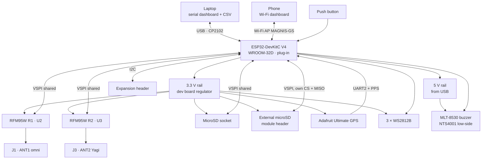

# MAGNIS v1 Ground Station
### Ignitia Rocket Lab · Tecnológico de Monterrey GDL

---

## What is this?

MAGNIS v1 is the ground station of Ignitia Rocket Lab's IGNIS avionics family. It receives the
real-time LoRa telemetry from the IGNIS flight computer and the team's CanSat with **two
receivers at once** (antenna diversity), logs every packet to a microSD card, and shows it live on
the laptop over USB and on any phone over its own Wi-Fi network.

It is designed to be **simple, reliable and easy to fix in the field**: the microcontroller is a
plug-in dev board, the GPS is a plug-in breakout, and every part can be swapped in seconds
without soldering. The same RF hardware, footprints and drivers as the IGNIS flight computer are
used, so the firmware and the lessons learned carry over directly.

---

## Competitions

MAGNIS is used in the competitions Ignitia Rocket Lab takes part in or plans to join:

| Competition | Name | Location |
|---|---|---|
| **IREC** | Intercollegiate Rocket Engineering Competition, Spaceport America Cup | New Mexico, USA |
| **LASC** | Latin American Space Challenge | Brazil |
| **ENMICE** | Encuentro Mexicano de Ingeniería en Cohetería Experimental | Mexico |

---

## Design Philosophy

v1 is built around four rules:

- **Swappable:** the ESP32 dev board and the GPS sit on female headers. If one fails, it is replaced in seconds.
- **Shared with IGNIS:** same RFM95W, SMA, microSD socket and LED footprints as the flight computer, and the same telemetry packet.
- **Assembled in Mexico:** almost every part is sourced from **UNIT Electronics**, with LCSC, Mouser and DigiKey as alternates.
- **Cheap to build:** 2-layer, 100 × 100 mm board, inside the low-cost PCB size class.

---

## Hardware at a Glance

| Block | Component |
|---|---|
| MCU | ESP32-DevKitC V4 · ESP32-WROOM-32D · plug-in on 2 × 19 female headers · CP2102 USB-UART |
| RF Telemetry | 2 × RFM95W · 915 MHz LoRa · antenna diversity · 2 × SMA edge connector |
| RF feed | 50 Ω grounded coplanar waveguide · via fence · π-match footprint (0 Ω + 2 DNP) per radio |
| GNSS | Adafruit Ultimate GPS breakout (PA1616S) · plug-in · PPS for time sync |
| Storage | MicroSD push-push socket (same as IGNIS v5) + 6-pin header for an external SPI module (own CS and MISO) |
| SPI | One shared bus on the native VSPI pins (2 radios + microSD) |
| Power | USB 5 V through the dev board · 3.3 V from the dev board regulator · 22–47 µF bulk capacitor |
| Indicators | 3× WS2812B RGB (3.3 V) · MLT-8530 magnetic buzzer (5 V, MOSFET low-side, PWM tone) |
| User input | Multi-purpose push button (input only, function assigned in firmware) |
| Expansion | 4-pin I2C header (3V3, GND, SDA, SCL) for an OLED or a sensor |
| Debug | 9 test points: SCK, MISO, MOSI, CS, CS_2, SD_CS, 3V3, 5V, GND |
| Host link | USB to laptop (serial dashboard + CSV lines) · Wi-Fi access point with a phone dashboard |
| PCB | 2-layer · 100 × 100 mm · 4 × M3 holes · Altium Designer · JLCPCB fabrication, assembled in Mexico |

### Antennas

| Radio | Module | Connector | Suggested antenna |
|---|---|---|---|
| R1 | U2 | J1 · ANT1 | 10 dBi omnidirectional, tilted toward apogee |
| R2 | U3 | J3 · ANT2 | 13 dBi Yagi-Uda, aimed by hand (the dashboard gives azimuth and elevation) |

Both antennas connect through extension cables. Do not let the cable weight hang from the
edge SMA connectors: use a panel (bulkhead) pigtail fixed to the case or the tripod.

### Link profiles

| Profile | Frequency | Spreading factor | Bandwidth | Sync word |
|---|---|---|---|---|
| Rocket (IGNIS flight computer) | 915.0 MHz | SF9 | 125 kHz | 0x12 |
| CanSat | 915.5 MHz | SF9 | 125 kHz | 0xAB |

Both radios listen to the same profile. The default is `ROCKET`; switch at any time with
`PROFILE:ROCKET` / `PROFILE:CANSAT` over USB, or from the phone dashboard.

> In Brazil (LASC) the channel must sit fully inside the 915–928 MHz band allowed by ANATEL.
> The frequencies are set in the firmware (`PROFILE_ROCKET`, `PROFILE_CANSAT`) and must match
> the transmitters.

---

## System Architecture



---

## Pin Map

Matches schematic MAGNIS-v1-SCH-01 rev 1.1. The net names follow the IGNIS flight computer.

| Net | GPIO | Note |
|---|---|---|
| SNS_SPI_SCK / MISO / MOSI | 18 / 19 / 23 | native VSPI · pull-ups on MISO and MOSI |
| RFM95W_CS / RESET / INT (R1, U2) | 21 / 25 / 32 | |
| RFM95W_CS_2 / RESET_2 / INT_2 (R2, U3) | 22 / 33 / 34 | INT_2 on an input-only pin |
| SD_CS | 16 | onboard slot · pull-up |
| SD_CS_EXT / SD_MISO_EXT | 4 / 39 | external module · MISO on an input-only pin |
| GPS_UART_TX / GPS_UART_RX | 17 / 5 | UART2 · `gpsSerial.begin(9600, SERIAL_8N1, 17, 5)` |
| GPS_PPS | 35 | input-only · rising edge = start of the UTC second |
| WS2812B_DATA | 14 | 33 Ω series resistor at LED1 |
| BUZZER | 13 | MOSFET gate · 10 kΩ pull-down · PWM tone at 2.7 kHz |
| BTN | 36 | input-only · external 10 kΩ pull-up · pressed = LOW |
| I2C_SDA / I2C_SCL | 26 / 27 | expansion header · pull-ups on the module (board footprints DNP) |
| **Do not connect** | 0, 1, 2, 3, 6–11, 12, 15 | strapping, UART0 (USB link), internal SPI flash |

> GPIO12 must never be pulled high at boot: it selects 1.8 V flash and the board will not start.
> GPIO36/39 can produce short glitches while Wi-Fi is on, so no interrupt uses them.

---

## PCB Layout (rev 1.1)

- **Placement:** the dev board stands vertically on the left edge with the USB port facing down, so
  its SPI pins (right column) face the radios, the GPS and the microSD. U3 sits above it, U2 at the
  top right, the GPS in the middle (moved +2.54 mm in X so the SPI bus fits beside its header),
  the microSD and the external SD header on the right, and the LEDs and buzzer along the bottom.
- **Routing:** all signals and power run on the top layer. The bottom layer is a solid GND plane,
  crossed only by short jumpers (23 in the routing model, the longest about 8 mm). The dev board
  and the GPS are plugged in on headers, so the area under them is used for routing; the dev board's
  Wi-Fi antenna end keeps a copper keepout.
- **Widths:** signals 0.254 mm (0.2 mm minimum clearance, bus at 0.7 mm pitch), 3V3 0.5 mm, 5V 0.6 mm.
  RF uses a 50 Ω grounded coplanar line (about 1.0 mm wide with a 0.18 mm gap, confirm with the
  Altium stackup) with a via fence on both sides.
- **Headers on the bottom silkscreen:** J2 (external SD): GND, MISO, SCK, MOSI, CS, 3V3 ·
  J4 (I2C): GND, 3V3, SCL, SDA, the same order as common SSD1306 OLED modules.
- **Notes:** the GPS EN resistor (R1) is not fitted because the Adafruit breakout already pulls EN
  high. The four M3 holes are GND pads.

Routing diagrams and the bottom silkscreen proposal are in `Docs/`.

---

## Firmware

`Firmware/MAGNIS_GS_v1/MAGNIS_GS_v1.ino` — **preliminary, not tested on hardware yet.**

**Arduino IDE settings:** board *ESP32 Dev Module*, Flash Size 4 MB, PSRAM disabled.
**Libraries:** RadioLib (jgromes, 7.x), Adafruit NeoPixel, TinyGPSPlus. WiFi, WebServer, SD, SPI
and Wire come with the ESP32 core.

### What it does

- **Diversity reception:** each packet usually arrives on both radios. The firmware keeps one copy
  per sequence number (the one with the best RSSI) and counts which radio got it: both, only R1 or
  only R2. That shows how much the second antenna actually adds. If one radio fails at boot, the
  station keeps working with the other.
- **Accepts RadioHead packets:** the FC transmits with RadioHead, which adds a 4-byte header. Packets
  with or without that header are accepted.
- **Time:** UTC from the GPS, disciplined by the PPS pulse (millisecond accuracy). Until the GPS
  has a fix, the laptop can set the time with `SETTIME:<unix_epoch>` (the station asks with
  `REQ_TIME`). Local time is Mexico Central (CST6).
- **Yagi aiming:** with a fix on both GPS, the station computes range, azimuth and elevation to the rocket.
- **Logging:** one CSV per session on the microSD (`/MAGNIS000.CSV`, `/MAGNIS001.CSV`, ...), flushed every row.
  If the card fails or is removed, it retries every 10 s.

### Interfaces

| Interface | Details |
|---|---|
| Wi-Fi dashboard | Network `MAGNIS-GS`, password `ignitia2026` → open `http://192.168.4.1`. Live state, both radios, aiming, GPS, SD. Buttons for profile and new log. JSON at `/api/state` |
| USB serial (115200) | Redrawn text dashboard every 500 ms + one `TLM,<csv row>` line per unique packet |
| Commands (USB or `/api/cmd?c=`) | `SETTIME:<epoch>` · `PROFILE:ROCKET` · `PROFILE:CANSAT` · `NEWLOG` · `BEEP` |
| Button | Short and long press detected; the actions are empty hooks (`onButtonShort`, `onButtonLong`) until a use is decided |
| I2C header | Scanned at boot; found addresses shown on the serial and web dashboards |

### Status LEDs

| LED | Meaning |
|---|---|
| LED1 · SD | green = logging · red = no card |
| LED2 · Link | blue flash = packet · green = both radios · yellow = only one radio · red = no packet for 5 s · amber = waiting |
| LED3 · GPS | green = fix · amber = searching · red = no data from the GPS |

### CSV columns

`datetime, unix_ms, recv_millis, time_src, profile, rx_mask, rssi_r1, snr_r1, rssi_r2, snr_r2`,
then every field of the FC packet (`seq` … `pyro2_fired`), then
`gs_lat, gs_lon, gs_alt_m, gs_sats, range_m, bearing_deg, elevation_deg`.
`rx_mask`: 1 = only R1, 2 = only R2, 3 = both.

---

## Project Structure

```
MAGNIS-v1-GroundStation/
├── PCB_Project_MAGNIS-v1-GroundStation/
│   ├── Project_Group_MAGNIS-v1-GroundStation.DsnWrk
│   ├── PCB_Project_MAGNIS-v1-GroundStation.PrjPcb
│   ├── Sch_MAGNIS-v1.SchDoc
│   └── PCB_MAGNIS-v1.PcbDoc
├── Firmware/
│   └── MAGNIS_GS_v1/
│       └── MAGNIS_GS_v1.ino
├── BOM/
│   ├── MAGNIS_v1_Parts_List.xlsx
│   └── MAGNIS_v1_Netlist.xlsx
├── Docs/
│   ├── MAGNIS_v1_routing_detailed.png
│   ├── MAGNIS_v1_routing_zooms.png
│   ├── MAGNIS_v1_bottom_silk_concept.png
│   └── MAGNIS_v1_QR.svg
├── LICENSE
└── README.md
```

The schematic is a **single sheet**: the board is simple enough that each block (ESP32-DevKitC V4,
LoRa Transceivers, GPS, MicroSD Storage, Pull-up Resistors, RGB Indicators, Magnetic Buzzer,
User I/O) is separated by a drawn frame on the same page.

---

## Design & Development

**Lead Designer & Author:** [Emilio Guadarrama](https://github.com/Emilio-Guadarrama)  
Vice President, Ignitia Rocket Lab · Avionics & Electronics Lead

**Team President:** Maximiliano Funoy Serrano  
**Faculty Advisor:** Dr. José Luis Henríquez Mercado

## Team

**Ignitia Rocket Lab**  
Tecnológico de Monterrey, Campus Guadalajara

📧 ignitia.rocketlab@gmail.com

---

## License

This project is open source under the [MIT License](LICENSE). You are free to use, modify and
share the design, including for your own rockets, as long as the original copyright notice is kept.

---

**Contact the author:** Emilio Guadarrama · [emilio.guadarrama@outlook.com](mailto:emilio.guadarrama@outlook.com)
