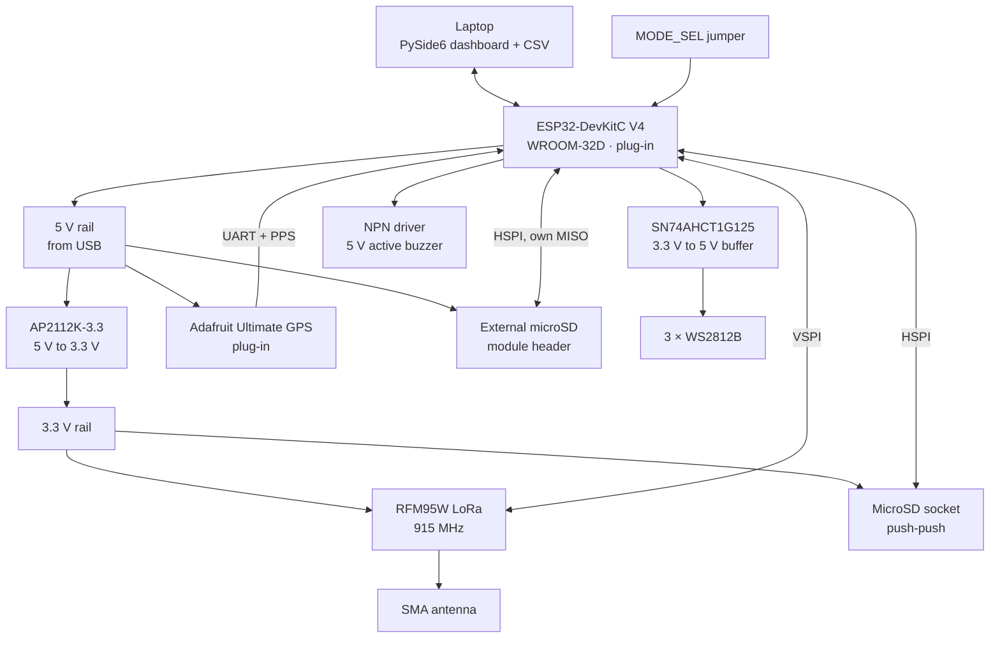

# VESTA v1 Ground Station
### Ignitia Rocket Lab · Tecnológico de Monterrey GDL

---

## What is this?

VESTA v1 is the ground station of Ignitia Rocket Lab's IGNIS avionics family. It receives the
real-time LoRa telemetry from the IGNIS flight computer and the team's CanSat, logs every packet
to a microSD card and streams it over USB to a live dashboard on the laptop.

It is designed to be **simple, reliable and easy to fix in the field**: the microcontroller is a
plug-in dev board, the GPS is a plug-in breakout, and every part can be swapped in seconds
without soldering. The same RF hardware, footprints and drivers as the IGNIS flight computer are
used, so the firmware and the lessons learned carry over directly.

*Vesta is the Roman goddess of the hearth fire: the home base that keeps the fire of IGNIS.*

---

## Competitions

VESTA is used in the competitions Ignitia Rocket Lab takes part in or plans to join:

| Competition | Name | Location |
|---|---|---|
| **IREC** | Intercollegiate Rocket Engineering Competition, Spaceport America Cup | New Mexico, USA |
| **LASC** | Latin American Space Challenge | Brazil |
| **ENMICE** | Encuentro Mexicano de Ingeniería en Cohetería Experimental | Mexico |

---

## Design Philosophy

v1 is built around four rules:

- **Swappable:** the ESP32 dev board and the GPS sit on female headers. If one fails, it is replaced in seconds.
- **Shared with IGNIS:** same RFM95W, SMA, microSD socket and LED footprints as the flight computer, and the same drivers; only the pin defines change.
- **Assembled in Mexico:** almost every part is sourced from **UNIT Electronics**, with LCSC, Mouser and DigiKey as alternates.
- **Cheap to build:** 2-layer, 100 × 100 mm board, inside the low-cost PCB size class.

---

## Hardware at a Glance

| Block | Component |
|---|---|
| MCU | ESP32-DevKitC V4 · ESP32-WROOM-32D · plug-in on 2 × 19 female headers · CP2102 USB-UART |
| RF Telemetry | RFM95W · 915 MHz LoRa · SMA edge connector · 50 Ω CPWG feed with π-match footprint |
| GNSS | Adafruit Ultimate GPS breakout (PA1616S) · plug-in · PPS for time sync |
| Storage | MicroSD push-push socket (same as IGNIS v5) + 6-pin header for an external SPI module · dedicated SPI bus |
| Power | USB 5 V from the dev board · AP2112K-3.3 LDO · solder-jumper fallback to the dev board 3.3 V · power LEDs |
| Indicators | 3× WS2812B RGB (5 V, buffered data line) · 5 V active buzzer |
| Configuration | MODE_SEL jumper · rocket or CanSat link profile, read at boot |
| Host link | USB to laptop · PySide6 + pyqtgraph live dashboard · per-session CSV logging |
| PCB | 2-layer · 100 × 100 mm · Altium Designer · JLCPCB fabrication, assembled in Mexico |

### Link profiles

| Profile | MODE_SEL | Spreading factor | Bandwidth | Sync word |
|---|---|---|---|---|
| Rocket (IGNIS flight computer) | Open | SF9 | 125 kHz | 0x12 |
| CanSat | Jumper fitted | SF9 | 125 kHz | 0xAB |

> In Brazil (LASC) the channel must sit fully inside the 915–928 MHz band allowed by ANATEL. The
> frequency is set in the firmware configuration.

One RFM95W listens to one profile at a time, so two identical boards are used for the two
missions or for antenna diversity.

---

## System Architecture



---

## Pin Map

The net names match the IGNIS flight computer, so porting the firmware only means changing the pin defines.

| Net | GPIO | Note |
|---|---|---|
| RFM95W_SCK / MISO / MOSI | 18 / 19 / 23 | VSPI |
| RFM95W_CS / RST / DIO0 | 5 / 27 / 26 | CS idles high at boot |
| RFM95W_DIO1 | 33 | optional |
| SD_SCK / SD_MOSI | 14 / 13 | HSPI, dedicated bus |
| SD_MISO_SLOT / SD_CS_SLOT | 34 / 15 | input-only MISO · external pull-ups |
| SD_MISO_EXT / SD_CS_EXT | 35 / 4 | external module |
| GPS_TX / GPS_RX | 16 / 17 | UART2 · `Serial2.begin(9600, SERIAL_8N1, 16, 17)` |
| GPS_PPS | 32 | |
| WS2812B_DIN | 25 | through the 3.3 → 5 V buffer |
| BUZZER | 22 | |
| MODE_SEL | 36 | input-only · pull-up · jumper fitted = CanSat |
| **Do not connect** | 0, 1, 2, 3, 6–11, 12 | strapping, UART0 (USB link), internal SPI flash |

> GPIO12 must never be pulled high at boot: it selects 1.8 V flash and the board will not start.

---

## Project Structure

```
VESTA-v1-GroundStation/
├── Schematics/
│   ├── Main.SchDoc
│   ├── Power.SchDoc
│   ├── RF_LoRa.SchDoc
│   ├── GPS.SchDoc
│   ├── Storage.SchDoc
│   └── Indicators.SchDoc
├── PCB/
│   └── VESTA_v1.PcbDoc
├── Libraries/
├── BOM/
│   └── VESTA_v1_Parts_List.xlsx
├── Firmware/
├── Dashboard/
└── Fabrication/
```

---

## Design & Development

**Lead Designer & Author:** [Emilio Guadarrama](https://github.com/Emilio-Guadarrama)  
Vice President, Ignitia Rocket Lab · Avionics & Electronics Lead

**Team President:** Maximiliano Funoy Serrano  
**Faculty Advisor:** Dr. José Luis Henríquez Mercado

## Team

**Ignitia Rocket Lab**  
Tecnológico de Monterrey, Campus Guadalajara

📧 ignitia.rocketlab@gmail.com

---

## License

This project is open source under the [MIT License](LICENSE). You are free to use, modify and
share the design, including for your own rockets, as long as the original copyright notice is kept.

---

**Contact the author:** Emilio Guadarrama · [emilio.guadarrama@outlook.com](mailto:emilio.guadarrama@outlook.com)
